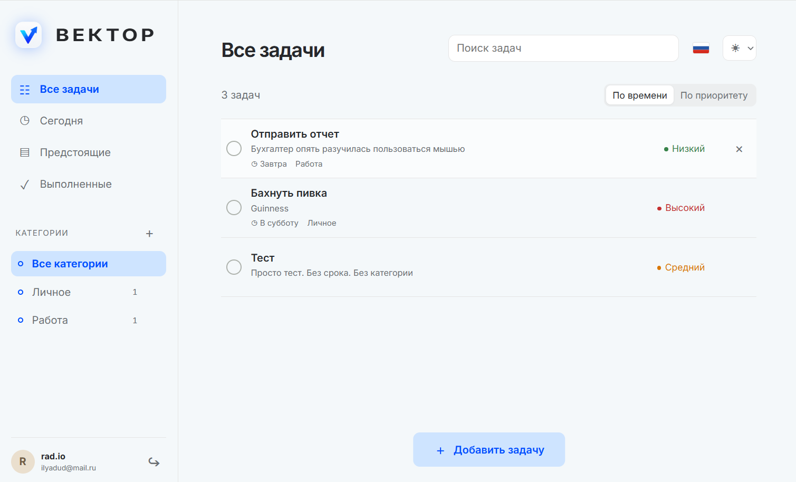

# Vector / Вектор

Веб-планировщик задач на Go и Vue 3. Все данные по умолчанию хранятся в `taskvector.db`, в будущем будет полная поддержка PostgreSQL.



## Запуск для разработки

Нужны Go 1.23+ и Node.js 20+.

```powershell
cd web
npm install
cd ..
make dev
```

Откройте `http://localhost:5173`. API работает на `http://localhost:8080`. Для другого пути к базе задайте `TV_DB_DSN`; адрес сервера можно изменить через `TV_HTTP_ADDR`.

Если API отвечает `error: internal`, подробности ошибки на сервере записываются в `taskvector-dev.log` в корне проекта. После обновления Go-кода необходим перезапуск процесса backend: он не перезагружается автоматически.

## Сборка (Windows)

```powershell
cd web
npm run build
cd ..
go build -o taskvector.exe ./cmd/taskvector
```

Для запуска бинарника соберите фронтенд: сервер раздаёт `web/dist`. Пример переменных конфигурации находится в `config.example.yaml`; реальные конфиги и база данных игнорируются Git.

## Реализовано

- Самостоятельная регистрация, вход и выход с HttpOnly cookie сессией.
- Локальная схема SQLite, категории и пользовательские задачи.
- Списки «Сегодня», «Предстоящие», «Все задачи», «Выполненные», поиск, сортировка, приоритеты и сроки.
- Отметка выполнения, повторное открытие и мягкое удаление задач.
- Интерфейс на русском и английском, светлая и тёмная тема, адаптивная раскладка.
- Валидация данных и изоляция записей по пользователю.

Пароли хранятся как Argon2id PHC-хеши. Уведомления, экран профиля, PostgreSQL и часть требований v1 ещё не завершены.
